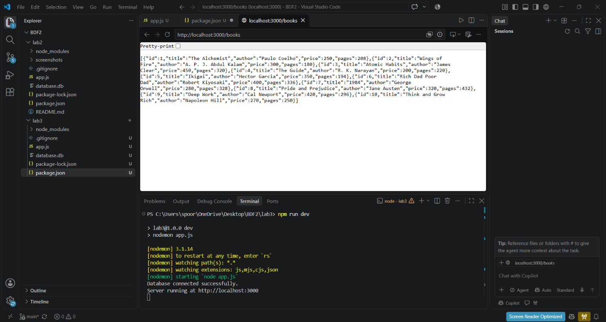
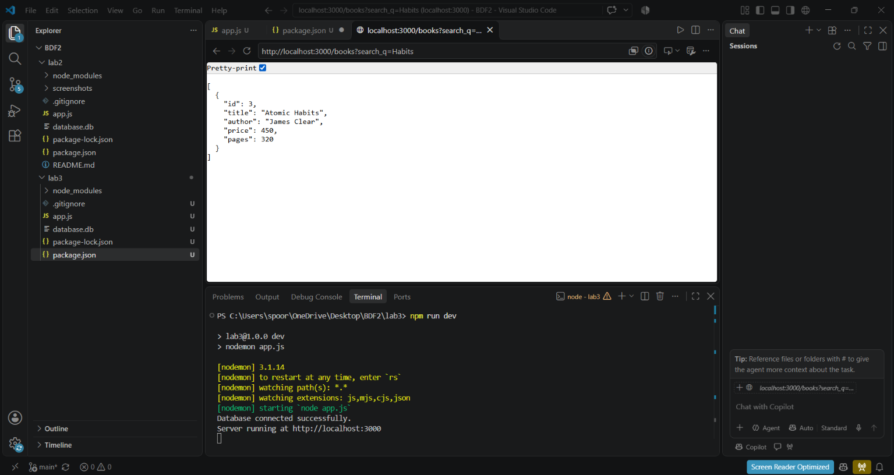
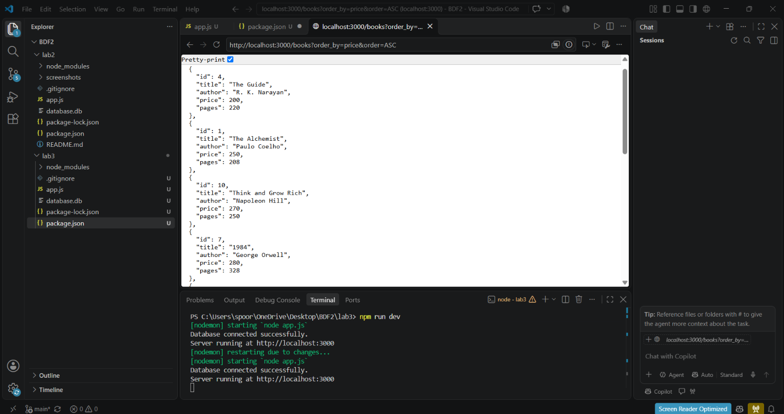
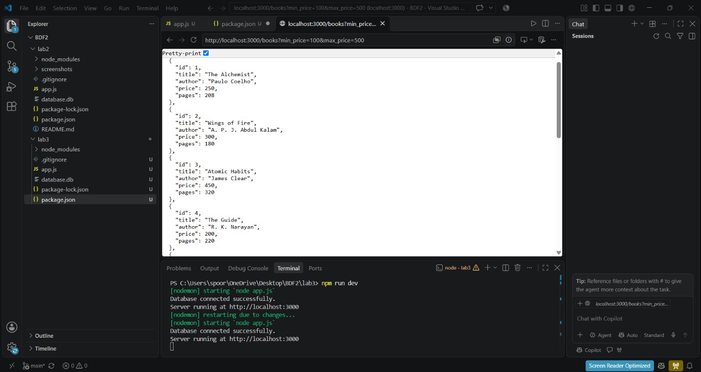
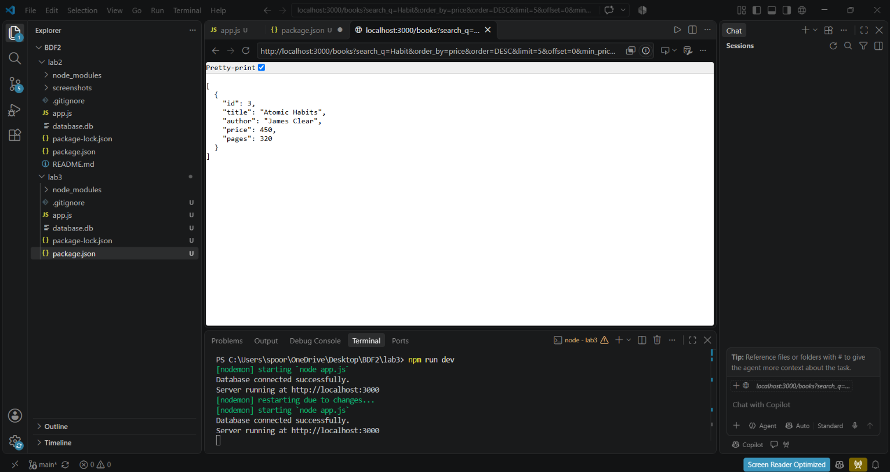
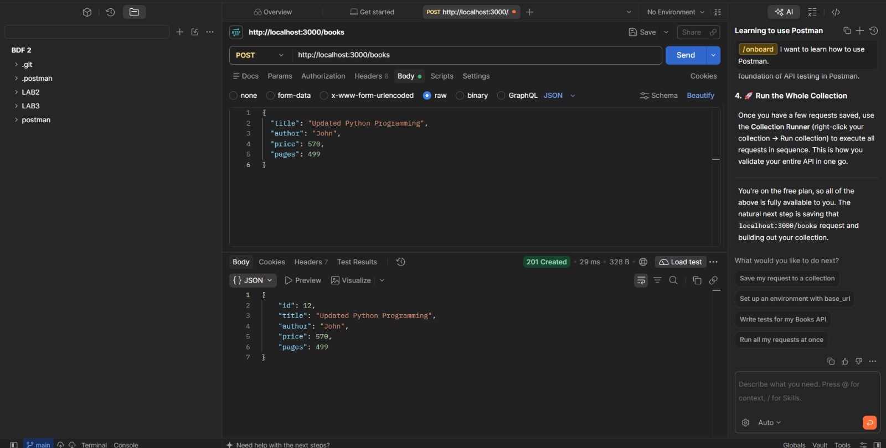
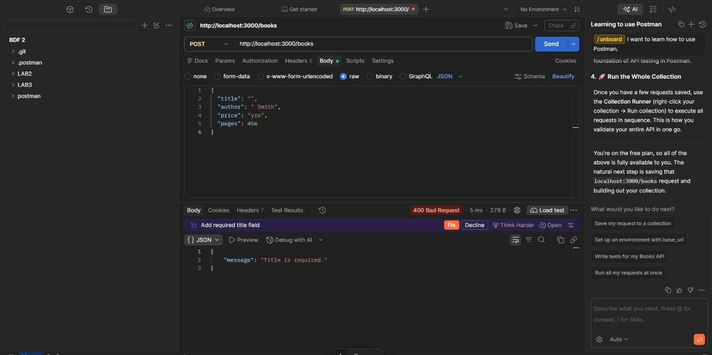
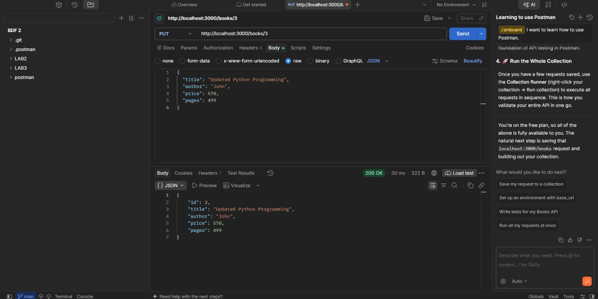
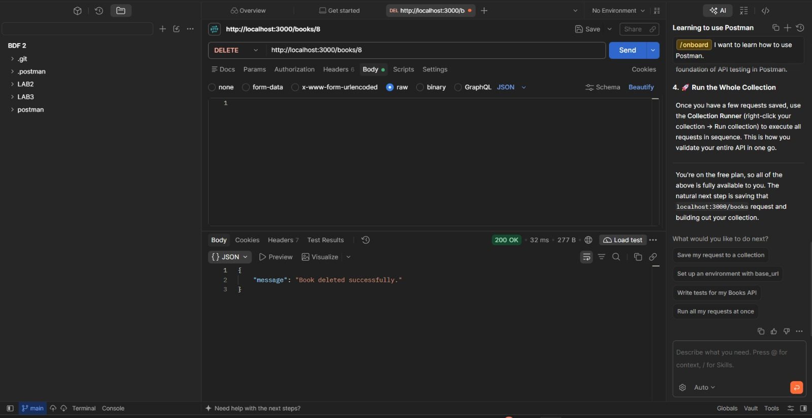

# Lab 3 – REST API, Query Parameters, Validation and Debugging

## Project Details

- **Name:** Daram Spoorthi
- **Registration Number:** 252U1R5036
- **Section:** S-10
- **Course:** Backend Development Fundamentals
- **Lab:** Lab 3 – REST API, Query Parameters, Validation and Debugging
- **Institution:** Aurora Deemed to be University
- **Faculty:** Shiva Sai Teja

## Deployment URL

**Render URL:** https://spoorthi-5036-lab3.onrender.com/books

## Project Description

This project implements RESTful API operations using Node.js, Express.js, and SQLite. It provides endpoints to create, retrieve, update, and delete book records.

It also supports searching, sorting, pagination, price filtering, input validation, and proper HTTP status codes.

## Technologies Used

- Node.js
- Express.js
- SQLite
- SQLite3
- JavaScript
- Postman
- Visual Studio Code

## Project Structure

```text
lab3/
│
├── app.js
├── database.db
├── package.json
├── package-lock.json
├── .gitignore
├── README.md
│
└── screenshots/
    ├── delete.jpeg
    ├── get-all.png
    ├── multiple-query.png
    ├── pagination.png
    ├── post-success.jpeg
    ├── post-validation.jpeg
    ├── price-filter.png
    ├── put-update.jpeg
    ├── search.png
    └── sorting.png
```

## Installation and Setup

### 1. Clone the Repository

```bash
git clone https://github.com/spoorthidaram/spoorthi_5036_lab3.git 
```

### 2. Open the Project Folder

```bash
cd lab3
```

### 3. Install Dependencies

```bash
npm install
```

### 4. Start the Development Server

```bash
npm run dev
```

The server runs at:

```text
http://localhost:3000
```

## API Endpoints

| HTTP Method | Endpoint | Description |
|---|---|---|
| GET | `/books` | Retrieve all books |
| GET | `/books/:bookId` | Retrieve a specific book |
| POST | `/books` | Add a new book |
| PUT | `/books/:bookId` | Update a book |
| DELETE | `/books/:bookId` | Delete a book |

## Query Parameters

### 1. Search Books

```text
GET /books?search_q=clean
```

Searches for books using a partial title.

### 2. Sorting

```text
GET /books?order_by=price&order=ASC
```

Sorts books by price in ascending order.

Use `DESC` for descending order.

### 3. Pagination

```text
GET /books?limit=5&offset=0
```

Returns five records starting from the first record.

### 4. Price Filtering

```text
GET /books?min_price=100&max_price=500
```

Retrieves books within the specified price range.

### 5. Combined Query

```text
GET /books?search_q=clean&order_by=price&order=DESC&limit=5&offset=0&min_price=100&max_price=1000
```

Combines searching, sorting, pagination, and price filtering.

## Request Body for POST and PUT

Select **Body → raw → JSON** in Postman.

```json
{
  "title": "Python Programming",
  "author": "John Smith",
  "price": 450,
  "pages": 320
}
```

## HTTP Status Codes

| Status Code | Description |
|---|---|
| 200 | Request successful |
| 201 | Book created successfully |
| 400 | Invalid input or query parameters |
| 404 | Book or route not found |
| 500 | Internal server error |

## Input Validation

The application validates:

- Book title must not be empty.
- Author name must not be empty.
- Price must be a valid non-negative integer.
- Pages must be a positive integer.
- Book ID must be a valid positive integer.
- Sorting order must be ASC or DESC.
- Pagination values must be valid.

## Postman Testing

All API endpoints are tested using Postman.

The tests include:

1. Add a book using POST.
2. Test invalid input validation.
3. Update a book using PUT.
4. Delete a book using DELETE.
5. Test invalid IDs and missing records.

## Screenshots

### 1. GET All Books



### 2. Search Books



### 3. Sorting



### 4. Pagination


### 5. Price Filtering



### 6. Multiple Query



### 7. POST Successful Request



### 8. POST Validation Error



### 9. PUT Update Request



### 10. DELETE Request



## Conclusion

This lab helped me understand REST API development using Node.js, Express.js, and SQLite. I implemented CRUD operations and learned how to use query parameters for searching, sorting, pagination, and price filtering. I also understood input validation, HTTP status codes, database integration, and debugging techniques. Postman helped me test the API endpoints and verify their responses.

---

**End of Lab 3**
